<p align="center">
  
</p>

<h1 align="center">Lumi</h1>

<p align="center">
  <strong>你的手机 AI 助手</strong><br>
  用自然语言操作手机，在任务中积累经验，记住你的偏好与习惯。
</p>

<p align="center">
  <a href="#演示">演示</a> ·
  <a href="#long-horizon">长程任务</a> ·
  <a href="#手机界面">手机界面</a> ·
  <a href="#轨迹工作台">轨迹工作台</a> ·
  <a href="#总体架构">总体架构</a> ·
  <a href="#开始使用">开始使用</a> ·
  <a href="#致谢">致谢</a>
</p>

<p align="center">
  <a href="LICENSE"></a>
  
</p>

## 项目介绍

Lumi 是基于 [OpenCyvis](https://github.com/opencyvis/opencyvis-phone) 开发的开源 Android 智能助手。你可以用文字或语音描述任务，让它结合屏幕画面和界面信息，完成点击、输入、滑动等操作。

在 OpenCyvis 的手机操作能力之上，Lumi 进一步加入任务上下文管理、长期记忆和学习功能。除了执行当前指令，我们也希望它能积累可复用的经验，更好地理解你的使用习惯。

**自然语言下达任务 · 后台操作手机 · 从经历中积累记忆与方法**

<details>
<summary>查看完整能力概览</summary>

| 能力 | 说明 |
| --- | --- |
| 手机操作 | 理解自然语言任务，根据界面与执行反馈逐步操作应用。 |
| 后台执行与接管 | 通过虚拟显示器执行任务，查看操作画面与文字进度，需要时人工接管。实际可用性取决于设备和目标应用。 |
| 长期记忆 | 保存用户偏好、应用知识和操作方法，支持检索、编辑、启停与查看来源。 |
| 向你学习 | 通过主动教学、任务复盘和授权观察整理经验，由你查看、修改并确认保存。 |
| 任务管理 | 管理任务队列，查看历史记录，支持暂停、取消与中断恢复。 |
| 多 Agent 协作 | 将分析、核对和编程工作交给协作助手，由主 Agent 审阅结果并继续执行。 |
| 轨迹工作台 | 在浏览器中回看任务步骤、手机画面、决策、上下文与 Memory 使用记录。 |
| 上下文与工具 | 结合任务状态、计划和历史信息推进任务，并支持 GUI、API 与 Python 混合执行。 |

学习功能使用已配置的模型整理操作经验，确认保存并启用后可供后续任务使用，不涉及模型权重训练。模型服务由你自行配置，可连接兼容的云端接口、私有部署或 Ollama 服务。

</details>

## 演示

**把任务交给 Lumi，继续使用你的手机。**

这段约 1 分 40 秒的实机录屏，从一条跨应用任务开始：在京东查找两款百元以内的无线鼠标，并将比较结果整理到原子笔记。视频展示任务发起、后台执行与悬浮进度查看；执行期间，前台仍可继续浏览其他应用。

<div align="center">

https://github.com/user-attachments/assets/b488ca72-3144-493a-ad24-3866b47db8c5

</div>

<p align="center"><sub>自然语言下达任务 → 虚拟显示器后台执行 → 悬浮面板查看画面与进度</sub></p>

<p align="center"><a href="docs/demos/lumi-demo.mp4">观看或下载原始 Demo</a> · <a href="#手机界面">浏览手机界面</a> · <a href="#轨迹工作台">查看执行轨迹</a></p>

<a id="long-horizon"></a>

## 长程任务（Long Horizon）

Lumi 的 Long Horizon 能力面向需要**跨页面收集信息、保持任务约束、处理后续变更并核对实际结果**的任务。以这次“微信求职通知 → 系统日历”为例：**13 步、约 2 分 28 秒，完成 12 项日程的创建与回读核验，全程没有人工接管。**

任务要求读取微信「文件传输助手」中“求职测试 1/4”到“求职测试 4/4”的四条通知，合并重复安排，以最后通知处理改期，排除取消项，再按统一标题和准确的起止时间写入日历，不修改其他日程。

<table align="center">
  <tr>
    <td width="50%" align="center" valign="top">
      <h3>Lumi</h3>
      <p><strong>13 步完成，保存 12 项日程</strong></p>
      <a href="docs/screenshots/lumi-long-horizon-result.jpg">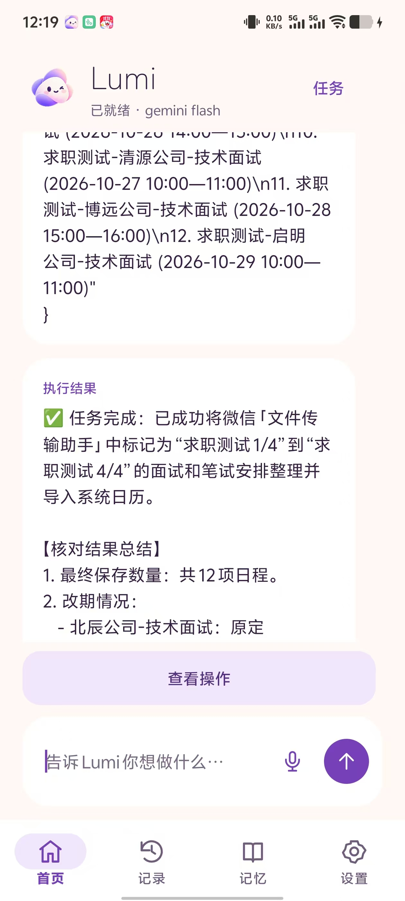</a>
    </td>
    <td width="50%" align="center" valign="top">
      <h3>OpenCyvis</h3>
      <p><strong>达到 100 步上限，任务未完成</strong></p>
      <a href="docs/screenshots/opencyvis-long-horizon-result.jpg">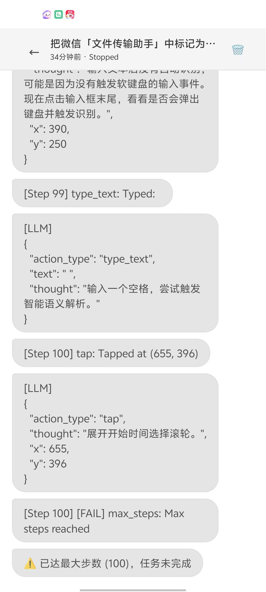</a>
    </td>
  </tr>
</table>

<p align="center"><sub>同一任务的一次实机对照：Lumi 的步数与耗时来自执行轨迹，OpenCyvis 的停止状态来自提供的截图。“100 步”指执行步数预算。</sub></p>

### 改期、取消与重复通知如何处理

Lumi 先读完四条通知，整理出最终有效安排，再统一写入。第 11 步日历接口返回：**新建 12 项、已有 0 项、失败 0 项、结果不明 0 项，整体 `verified: true`**。以下时间均为 **2026 年北京时间**。

| 通知变化 | 最终处理结果 |
| --- | --- |
| 北辰公司技术面试改期 | 由 10 月 23 日 09:30—10:30 改为 **10 月 26 日 09:30—10:30**，本次仅写入新时间。 |
| 云帆公司技术面试改期 | 由 10 月 22 日 15:00—16:00 改为 **当日 16:00—17:00**，本次仅写入新时间。 |
| 晨光公司技术面试取消 | 原定 10 月 24 日 10:00—11:00，**未添加**。 |
| 远山公司笔试、青禾公司面试重复提醒 | 合并重复通知，**各保留一项**。 |

<details>
<summary>查看完整任务指令</summary>

> 把微信「文件传输助手」中标记为“求职测试 1/4”到“求职测试 4/4”的四条消息里的面试和笔试安排，整理到系统日历。
>
> 重复通知只记一次；有改期的以最后通知为准，旧时间不保留；已取消的不添加。所有时间均为 2026 年北京时间。
>
> 日历标题统一为“求职测试-公司名称-技术面试”或“求职测试-公司名称-在线笔试”。保留准确的开始和结束时间，不修改其他日程。
>
> 完成后核对实际保存结果，告诉我最终保存了多少项，以及哪些安排改期或取消。

</details>

### 从信息采集到结果核验

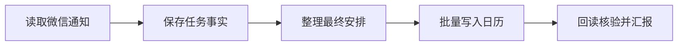

1. **读取时保留事实**：第 7～9 步将四条通知的要点写入带来源步骤的任务记忆，保留原始时间、变更与取消信息，离开页面后仍可用于决策。
2. **GUI 与原生 API 衔接**：通过微信界面采集通知，第 9～10 步查询日历能力与可写日历，第 11 步将整理好的 12 项安排交给 `calendar.import_events`，减少逐项操作日期、时间选择器的交互。
3. **用实际保存结果收尾**：日历接口写入后读回真实事件并核验字段；第 12 步根据证据完成计划，第 13 步汇报总数、改期和取消情况。本例没有调用子 Agent 或 Python。

<p align="center">
  <a href="docs/screenshots/lumi-long-horizon-workbench.png">
    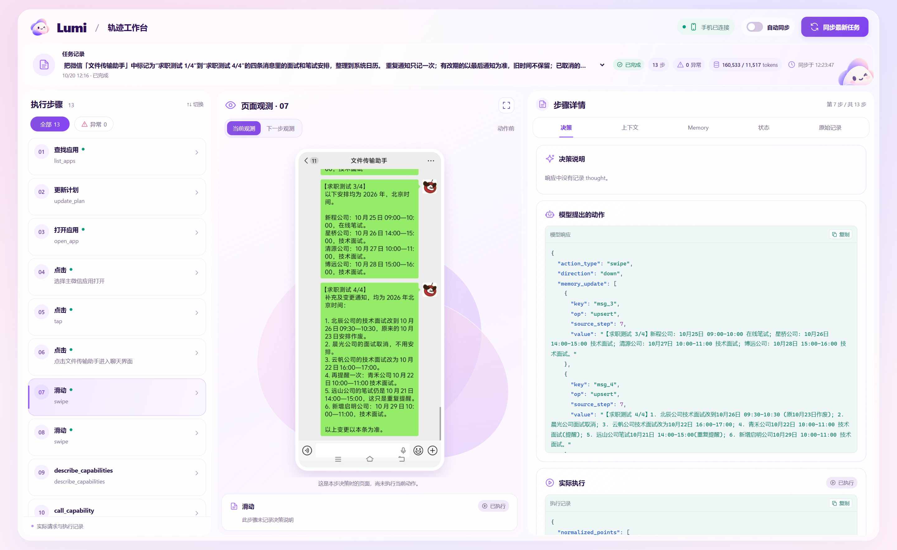
  </a>
</p>

<p align="center"><sub>第 7 步：中间是含改期、取消与重复提醒的微信原文，右侧是随本次动作保存的任务事实；顶部展示整次运行的步数与 Token 用量。</sub></p>

<details>
<summary>查看第 11 步：批量写入与回读核验</summary>

<p align="center">
  <a href="docs/screenshots/lumi-long-horizon-verification.png">
    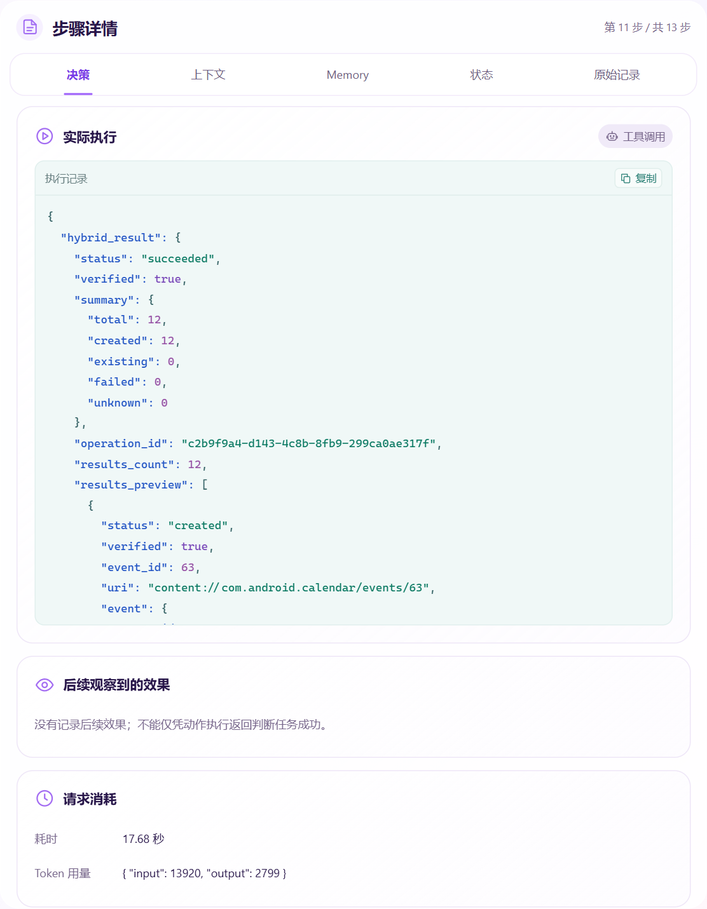
  </a>
</p>

截图取自工作台的步骤详情面板，展示接口返回的创建数量、核验结果和真实日历事件编号。

</details>

### 长程任务中的上下文管理

本次运行每轮请求只携带 **1 张当前页面截图**，四条通知通过结构化任务事实持续保留。模型报告的单次输入为 **8,554～20,007 tokens**，13 步累计输入 **160,533 tokens**、输出 **11,517 tokens**；累计输入是各轮之和，不是单次上下文长度。

对于更长任务，Lumi 还会按预算压缩已结束的历史，并支持按需回查原始证据，避免把所有历史画面与长文本反复送入后续决策。**本例没有触发历史压缩**，其实际执行路径是任务事实管理与 GUI／原生 API 协同。

测试者还观察到，OpenCyvis 在本次试用后期出现上下文膨胀、模型推理响应显著拉长的现象。本例的执行步骤、输入规模和日历回读结果来自 Lumi 的归档轨迹，OpenCyvis 的最终停止状态见上面的对照截图。

本案例来自 **2026-10-20 的本地最新演示构建**；其中批量日历导入接口尚未随当前公开源码快照发布。

## 手机界面

从任务管理到长期记忆，Lumi 将执行记录和经验整理放在可查看、可管理的界面中。以下均为实际截图，点击可查看原图。

<table align="center">
  <tr>
    <td width="50%" align="center" valign="top">
      <h3>任务队列</h3>
      <p>发起任务，管理状态与历史。</p>
      <a href="docs/screenshots/lumi-task-queue.jpg">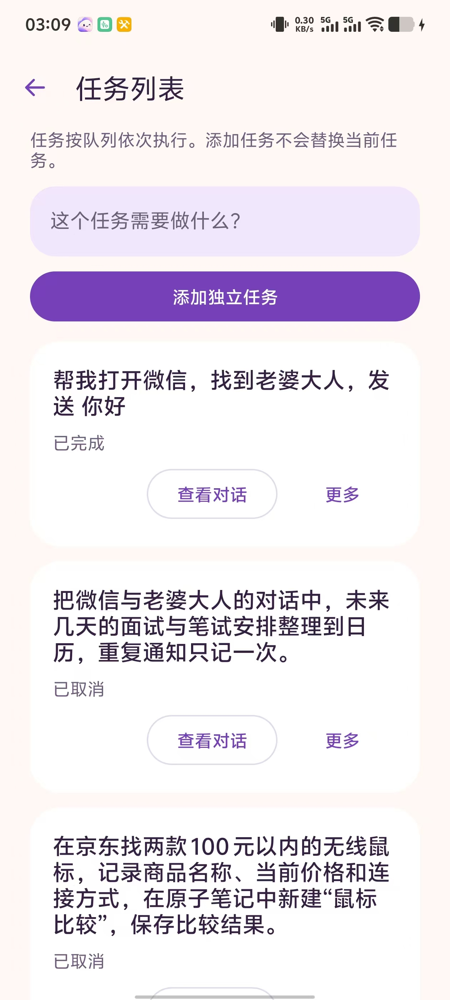</a>
    </td>
    <td width="50%" align="center" valign="top">
      <h3>任务记录</h3>
      <p>回看指令、执行过程与结果。</p>
      <a href="docs/screenshots/lumi-task-detail.jpg">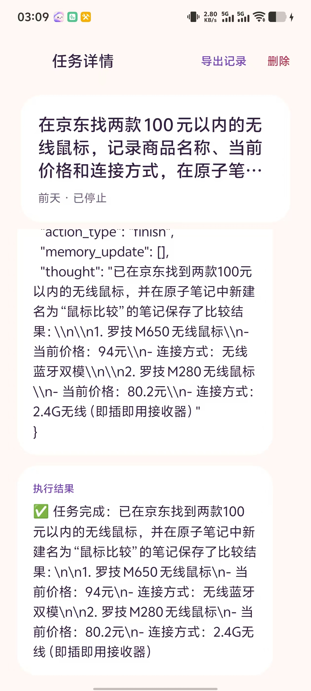</a>
    </td>
  </tr>
  <tr>
    <td width="50%" align="center" valign="top">
      <h3>长期记忆</h3>
      <p>管理经验，查看来源与状态。</p>
      <a href="docs/screenshots/lumi-memory.jpg">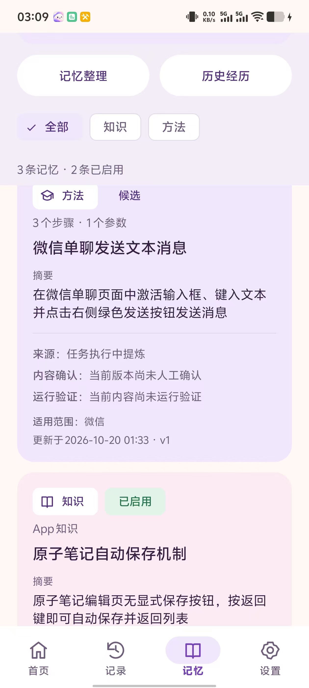</a>
    </td>
    <td width="50%" align="center" valign="top">
      <h3>学习中心</h3>
      <p>主动教学、任务复盘、授权观察。</p>
      <a href="docs/screenshots/lumi-learning.jpg">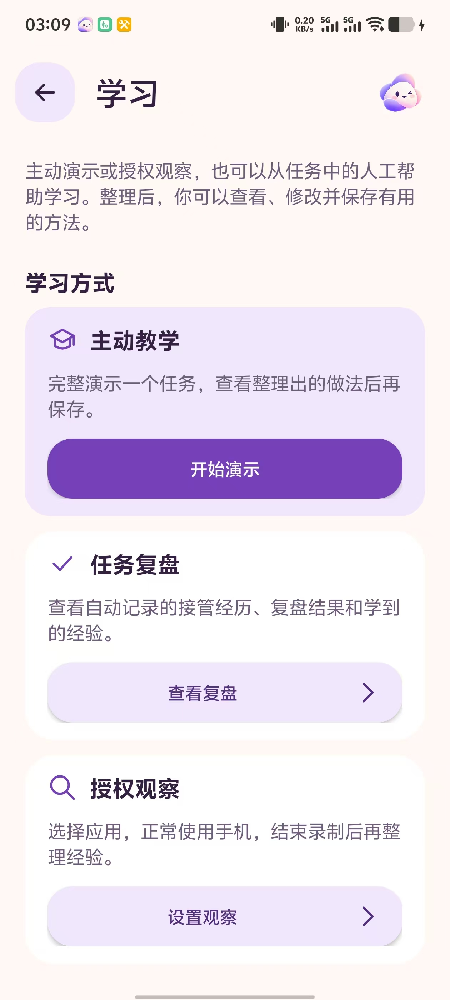</a>
    </td>
  </tr>
</table>

<p align="center"><sub>任务执行留下记录，操作经验沉淀为记忆，新的方法也可以通过你的演示来学习。</sub></p>

## 轨迹工作台

除了手机端，Lumi 还提供本地轨迹工作台，将**执行步骤、页面观测与 Agent 决策**放在同一视图中。选中任意一步，就能回看当时的手机画面、模型输入与输出，以及实际执行结果，方便理解任务过程和排查问题。

<p align="center">
  <a href="docs/screenshots/lumi-trace-workbench.png">
    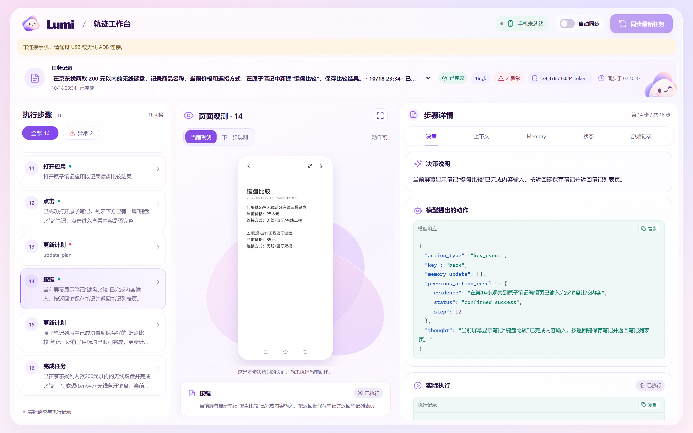
  </a>
</p>

<p align="center"><sub>“键盘比价并保存笔记”任务的实际轨迹：左侧切换步骤，中间回看笔记页面，右侧查看决策与执行证据。点击图片可查看原图。</sub></p>

<details>
<summary>再看一张：等待与人工接管时的执行轨迹</summary>

<p align="center">
  <a href="docs/screenshots/lumi-workbench-handoff.png">
    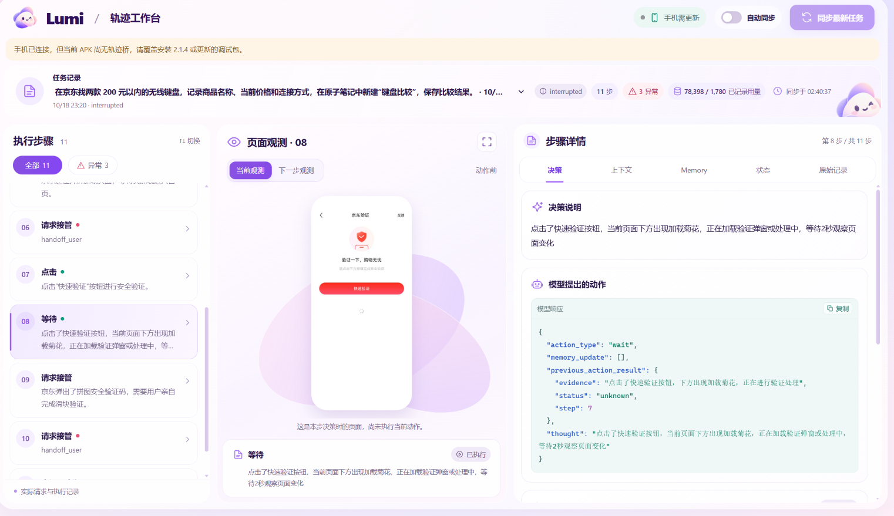
  </a>
</p>

这张截图展示任务中断与接管相关的记录。将页面观测与执行详情放在一起，可以对照查看任务停在哪里、当时看到什么，以及后续如何处理。

</details>

- **逐步回看**：按任务与步骤浏览轨迹，筛选异常，并对照当前与下一步页面观测。
- **检查决策依据**：查看决策、实际请求上下文、Memory、状态和原始记录，追踪每一步的输入与结果。
- **查看执行开销**：展示记录中的耗时和 Token 用量，辅助分析任务执行过程。
- **本地同步与离线查看**：连接支持轨迹导出的调试版 App 后可手动或定时自动同步；已归档记录可离线回看。

在仓库根目录启动：

```powershell
.\scripts\start-trace-viewer.ps1 -Port 8766
```

随后打开本机地址 `http://127.0.0.1:8766/`。工作台展示各步骤归档的观测画面与执行记录；启动时加上 `-AutoSync` 可开启自动同步。

实现入口：[轨迹工作台](tools/trace_viewer/server.py)、[启动脚本](scripts/start-trace-viewer.ps1)。

<details>
<summary>更多展示素材</summary>

[项目页面截图](docs/screenshots/lumi-project-page.png) · [原始 Demo](docs/demos/lumi-demo.mp4)

</details>

## 技术选型

Lumi 以原生 Android 应用为主体，将手机操作、任务推理、后台整理与本地数据管理分开实现。

| 层次 | 选型 | 用途 |
| --- | --- | --- |
| 应用与界面 | Kotlin、XML Views、AndroidX、Material Components | 对接 Android 生命周期、权限与原生交互。 |
| 任务引擎 | Kotlin Coroutines、StateFlow | 调度任务、传递运行状态，处理暂停、接管与取消。 |
| 模型接入 | OkHttp、统一 LLM 客户端接口 | 接入兼容接口、Anthropic 和 Ollama 等模型服务，复用工具调用协议。 |
| 手机控制 | 虚拟显示器、AIDL、Shizuku / ADB、系统权限后端 | 将截图、输入和应用管理封装为统一能力，适配 standard / system 两种模式。 |
| 本地数据 | Room、SQLite FTS、任务文件档案 | 保存记忆、版本、任务和学习会话；全文检索相关经验，归档截图与执行产物。 |
| 后台整理 | WorkManager | 持久化调度记忆整理与学习解析，保存进度并支持中断恢复。 |
| 代码执行 | Chaquopy、CPython 3.11、openpyxl | 在设备上执行 Python，处理文件、数据与普通表格，复用参数化程序。 |
| 语音输入 | Sherpa-ONNX、ONNX Runtime | 在设备端完成语音识别，将语音转换为任务输入。 |
| 轨迹分析 | Python 本地服务、HTML / CSS / JavaScript | 在浏览器中呈现任务档案、页面截图与决策详情。 |

## 总体架构

<p align="center">
  <a href="docs/brand/lumi-architecture.png">
    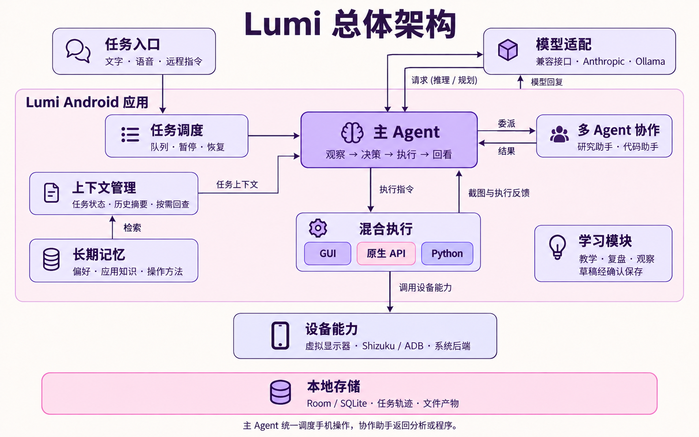
  </a>
</p>

主 Agent 负责推进目标，并统一调度手机操作；上下文与记忆为决策提供当前状态和已有经验。研究助手与代码助手处理可拆分的子任务，执行层连接 GUI、原生 API 和 Python。任务轨迹持续保存在本地，既用于历史回查，也为记忆整理和学习提炼提供素材。

## 模块与流程

### 任务执行与上下文

任务进入队列后，主 Agent 循环观察界面、组织上下文、请求模型决策并执行工具。上下文包含任务目标、计划、已确认事实、执行反馈和相关记忆；当输入预算紧张时压缩已结束的历史片段，完整记录仍可按需回查。

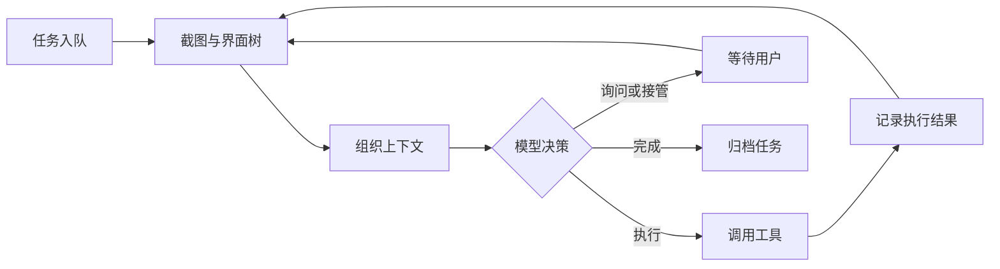

实现入口：[任务引擎](android/app/src/main/java/ai/opencyvis/engine/AgentEngine.kt)、[上下文管理](android/app/src/main/java/ai/opencyvis/engine/ContextManager.kt)。

### 记忆模块

长期记忆保存用户偏好、应用知识和可复用的操作方法，并关联来源与版本。执行时随目标、应用、页面或记忆版本变化刷新检索，也支持失败后的重检索和主动搜索；将简短记忆卡片注入上下文，需要时再读取详细步骤或原始证据。检索基于 SQLite 全文搜索与排序。

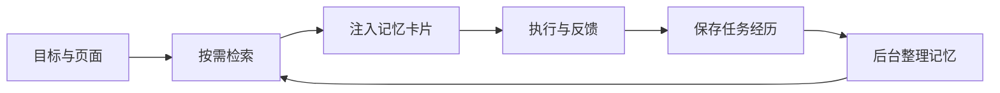

用户明确要求“记住”的事实可以直接保存。普通任务结束后，后台整理会按来源、版本和执行证据更新记忆：有独立执行成功证据的内容可以自动启用，其余保留为候选；手工维护的内容不会被后台自动替换。教学等学习入口产生的草稿则经过用户确认后保存。

实现入口：[记忆会话](android/app/src/main/java/ai/opencyvis/memory/MemorySession.kt)、[记忆仓库](android/app/src/main/java/ai/opencyvis/memory/MemoryRepository.kt)。

### 学习模块

学习模块将人工操作整理为后续可检索、可复用的经验，提供三种素材入口：

| 入口 | 如何产生素材 |
| --- | --- |
| 主动教学 | 说明教学目标、选择应用，在任务显示屏中演示操作。 |
| 任务复盘 | 记录任务中的人工接管，等待原任务结束后，结合前后经过判断是否存在值得提炼的操作纠正。 |
| 授权观察 | 选择应用范围并授权采集，在实际手机界面中操作，记录画面与操作线索。 |

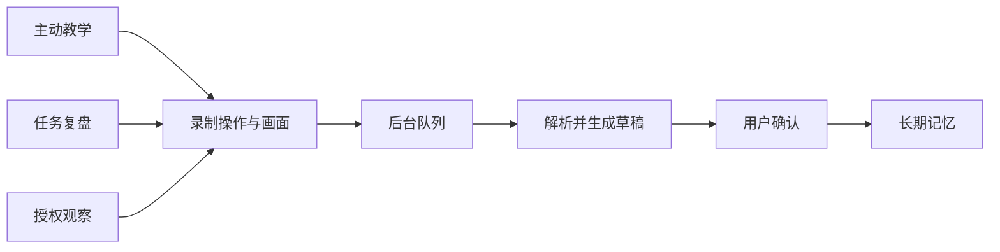

整理过程结合已有记忆生成方法、知识或偏好草稿，保留来源并支持补充问题，保存前可补充说明或编辑草稿。学习整理复用记忆模块的持久化后台队列，与前台任务执行分开调度；不是每次接管都会生成新方法。

实现入口：[素材录制](android/app/src/main/java/ai/opencyvis/learning/LearningRecorder.kt)、[学习处理](android/app/src/main/java/ai/opencyvis/learning/LearningProcessor.kt)。

### 多 Agent 协作

主 Agent 可将分析或编程工作拆成子任务，并提供已有证据、文件与完成条件。研究助手负责比较、整理和核对已有材料；代码助手负责编写 Python，处理数据并读回结果。涉及 GUI 的候选程序交回主 Agent 决定执行。

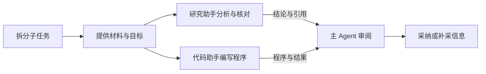

协作助手可与主任务的信息采集并行，共用任务预算，结果由主 Agent 审阅后纳入任务。手机 GUI 由主 Agent 统一调度；研究助手读取已有材料，不独立联网或操作手机。

实现入口：[协作会话](android/app/src/main/java/ai/opencyvis/engine/TeamSession.kt)、[子任务调度](android/app/src/main/java/ai/opencyvis/team/DelegationManager.kt)。

### 混合执行

| 通道 | 适合的工作 |
| --- | --- |
| GUI | 根据截图和界面结构完成应用交互，执行后读取新状态。 |
| 原生 API | 通过已提供的文件、日历等能力完成结构化操作。 |
| Python | 处理数据、文件和普通表格，将结果与产物交回任务；可将程序保存后复用。 |

执行流程为：**选择通道 → 执行操作或程序 → 读回状态与产物 → 更新任务上下文 → 继续决策**。GUI 程序共享当前任务的操作通道，Python 实际执行按进程级单槽调度。

实现入口：[混合执行运行时](android/app/src/main/java/ai/opencyvis/execution/TaskExecutionRuntime.kt)。

## 开始使用

### 普通手机：安装 APK 后按引导启用

**推荐使用 Lumi 标准版，适用于 Android 11 及以上的普通手机，无需 Root、系统签名或修改 ROM。** 标准版通过 ADB 无线调试或 Shizuku 等普通开发者、用户可以获得的授权能力操作手机，基本启用方式沿用 OpenCyvis。

拿到标准版 APK 后，安装、配对和授权均可在手机上完成，无需连接电脑。使用云端模型时，也无需另外部署 Lumi 服务端。

1. **安装应用并连接 Wi-Fi**：安装已构建的 Lumi 标准版 APK；自行编译请看[本地构建](#本地构建)。
2. **开启无线调试**：按应用引导打开系统的开发者选项，开启“无线调试”，再选择“使用配对码配对设备”。
3. **输入六位配对码**：在 Lumi 的配对界面或下拉通知栏中的 Lumi 通知里输入配对码，等待连接成功。
4. **完成权限配置**：按提示允许通知、悬浮窗及后台运行；使用语音输入时再授予麦克风权限。
5. **配置模型**：在设置中选择服务商，填写接口地址、模型名称和 API Key，并配置当前模型的**上下文窗口与输出预留**。所用模型需支持图像理解及对应的工具调用协议，预算应与实际模型服务的限制一致。
6. **开始使用**：回到首页输入或说出任务，查看执行进度；需要时通过悬浮面板查看任务画面或人工接管。

如果手机上已经启动 **Shizuku**，可直接向 Lumi 授权，替代上述应用内无线配对步骤。重启手机或调试连接失效后，按应用提示重新连接；厂商 ROM 的开发者选项入口与后台运行设置可能有所不同。

记忆和学习功能的数据保存在手机端，整理经验时调用已配置的模型。电脑上的**轨迹工作台是可选的查看与调试工具**，不影响手机独立执行任务。

### 权限来源与其他部署方式

| 使用方式 | 权限来源与要求 | 适用场景 |
| --- | --- | --- |
| 标准版 + ADB 无线配对（推荐） | 用户开启开发者选项与无线调试，配对后使用 ADB shell 权限；无需 Root、平台签名或改 ROM。 | 普通用户在自己的手机上安装使用。 |
| 标准版 + Shizuku | 启动 Shizuku 并向 Lumi 授权；未 Root 的 Android 11 及以上设备可通过无线调试启动 Shizuku。 | 已使用 Shizuku 的用户。 |
| 已 Root 设备 + Shizuku | 可通过 Root 启动 Shizuku，再向 Lumi 授权；Lumi 仍通过 Shizuku 后端连接。 | 已有 Root 环境的开发与使用场景。 |
| 系统版 / ROM 集成 | 使用与目标系统匹配的平台签名、系统身份和权限白名单，按目标设备集成系统镜像。 | 可控制系统镜像与签名的设备集成、AOSP 开发环境。 |

Root 启动与无线调试启动的具体操作见 [Shizuku 官方用户手册](https://shizuku.rikka.app/zh-hans/guide/setup/)。Lumi 当前提供 ADB、Shizuku 和系统权限后端，未提供独立的 `su` 连接入口；仅取得 Root 权限不等同于完成系统版部署。系统签名与修改 ROM 属于可选的系统集成路径，具体要求见[系统版构建与部署](android/README-AOSP.md)。

## 本地构建

构建环境：**JDK 17、Android SDK 36、NDK、CMake 3.22 及以上、Python 3.11**。项目自带 Gradle Wrapper，也可以使用 Android Studio 打开 `android` 目录。

当前标准版构建需要自行准备普通 APK 签名，**不需要厂商平台签名**；直接安装已构建 APK 的用户无需执行本节。以下命令从仓库根目录执行。

<details>
<summary>首次构建：准备本地签名</summary>

在 PowerShell 中创建签名目录和密钥库，并按提示设置密码：

```powershell
New-Item -ItemType Directory -Force .\android\signing
keytool -genkeypair -storetype JKS -keystore .\android\signing\standard.keystore -alias lumi -keyalg RSA -keysize 2048 -validity 10000
```

新建 `android/signing/standard.properties`，将占位内容替换为刚才设置的密码：

```properties
storePassword=YOUR_STORE_PASSWORD
keyAlias=lumi
keyPassword=YOUR_KEY_PASSWORD
```

签名文件和本机的 `android/local.properties` 均不提交到仓库。后续覆盖更新同一个安装包时，需要继续使用相同的签名密钥。

</details>

在 Windows PowerShell 中构建：

```powershell
cd android
java -cp .\gradle\wrapper\gradle-wrapper.jar org.gradle.wrapper.GradleWrapperMain :app:assembleStandardDebug
```

在 Linux 或 macOS 中构建：

```bash
cd android
./gradlew :app:assembleStandardDebug
```

如需指定 Python 3.11 的位置，可在构建命令后添加 `-Pchaquopy.buildPython=<解释器绝对路径>`。APK 输出到 `android/app/build/outputs/apk/standard/debug/`。

本地单元测试与 Android lint 对应的 Gradle 任务为 `:app:testStandardDebugUnitTest` 和 `:app:lintStandardDebug`。设备端测试需要连接 Android 真机或模拟器。

系统版构建与 AOSP 部署见 [系统应用部署说明](android/README-AOSP.md)。为兼容已有安装与配置，当前保留 `ai.opencyvis` 包命名空间及 `opencyvis://` 配置协议。

## 反馈与贡献

欢迎通过 [Issues](https://github.com/Iwtbs27/Lumi/issues) 提交问题和建议，或通过 Pull Request 参与改进。反馈操作问题时，请附上设备型号、Android 版本、模型配置和复现步骤。

## 致谢

**感谢 [OpenCyvis](https://github.com/opencyvis/opencyvis-phone) 及其贡献者的开源工作。** Lumi 基于 OpenCyvis 开发，沿用其 Android 手机操作、虚拟显示器与权限后端等基础，并在此基础上继续探索记忆、学习和任务执行体验。

原项目地址：[github.com/opencyvis/opencyvis-phone](https://github.com/opencyvis/opencyvis-phone)。

同时感谢 [Sherpa-ONNX](https://github.com/k2-fsa/sherpa-onnx) 提供端侧语音识别支持，以及项目使用的其他开源组件。

## 许可证

本项目采用 [Apache License 2.0](LICENSE)。保留 OpenCyvis 的版权与第三方声明，详见 [NOTICE](NOTICE)。
